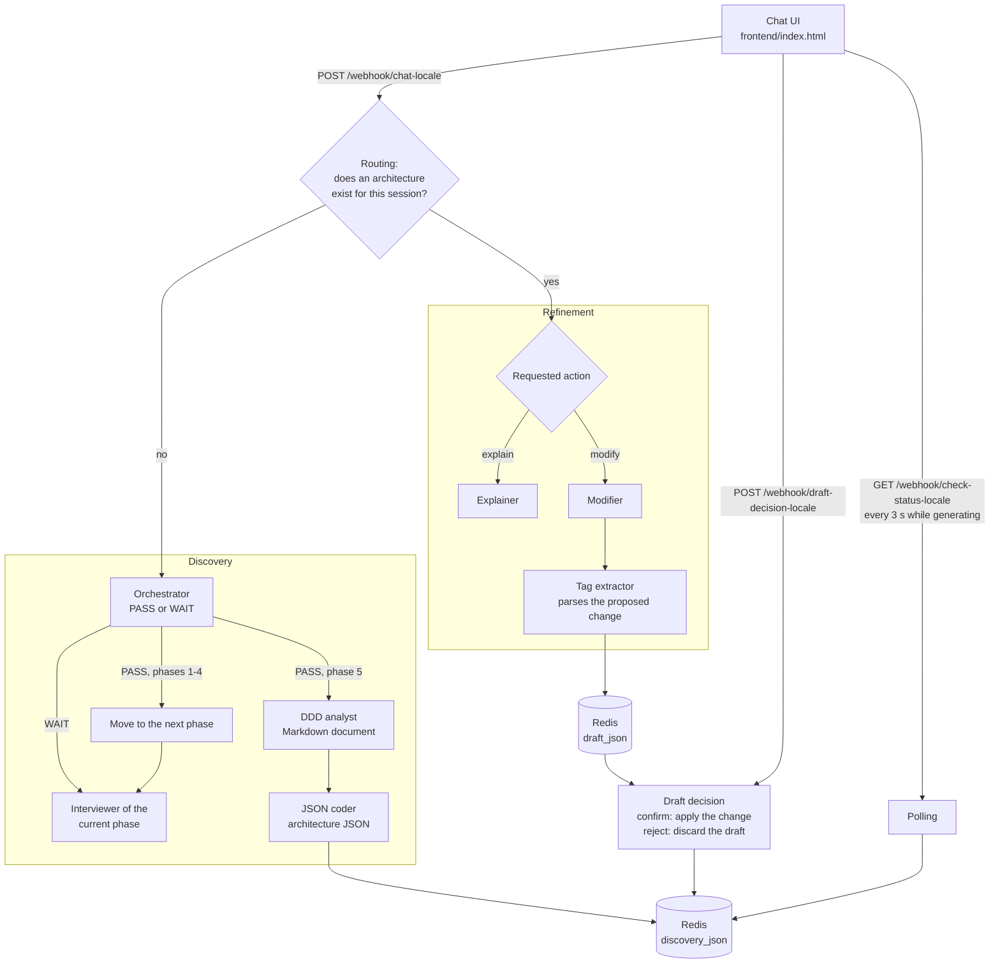
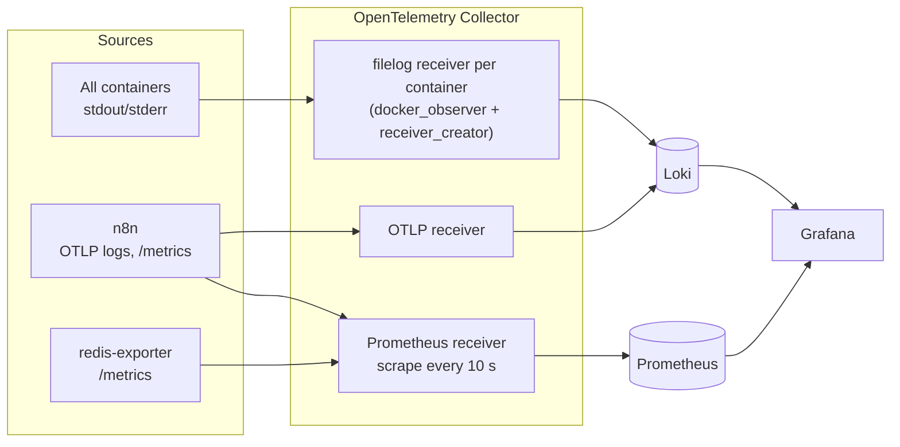

# DDD Interviewer: a multi-agent LLM system for Domain-Driven Design

A team of local LLM agents interviews a stakeholder about their business domain, produces a **Domain-Driven Design (DDD) architecture as JSON** and lets the user refine it through **human-approved changes**. The system runs as eight Docker containers, with logs and metrics collected through **OpenTelemetry** and visualised in **Grafana**.

Team project for the course *Intelligent Architectures: Microservices Programming for AI* (MSc in Intelligent Systems Engineering, Università Campus Bio-Medico di Roma, 2025/26), developed by Gianluca Barnaba, Luca Scorza and Federico Principi. The full technical documentation (51 pages, in Italian) is in [`documentation_DIM.pdf`](documentation_DIM.pdf).

## Highlights

- **Ten LLM agents** orchestrated with **n8n** and served locally by **Ollama** (`qwen2.5:14b`, `llama3`), so no data leaves the machine.
- **Phase-gated interview**: five specialised interviewer agents cover the five phases of DDD discovery, and after every user turn a validator agent decides whether the current phase is complete (`PASS`) or needs more detail (`WAIT`).
- **Two-step generation**: an analyst agent writes the architecture document in Markdown, then a parser agent translates it 1:1 into a fixed JSON schema.
- **Human-approved refinement**: an explainer agent answers questions about the architecture; a modifier agent proposes structured changes (`ADD`, `MODIFY`, `DELETE`, `MOVE`) that are applied to the JSON by deterministic code only after the user confirms twice.
- **Observability**: the logs of every container and the metrics of n8n and Redis flow through an OpenTelemetry Collector into Loki and Prometheus, with a provisioned Grafana dashboard.

## Architecture

| Container | Image | Role |
|---|---|---|
| `n8n` | `docker.n8n.io/n8nio/n8n` | Runs the five agent workflows and exposes them as webhooks |
| `ollama` | `ollama/ollama` | Serves the LLMs locally |
| `redis` | `redis:alpine` | Session state: interview phase, chat memories, architecture JSON, drafts |
| `otel-collector` | `otel/opentelemetry-collector-contrib:0.133.0` | Collects logs and metrics and routes them to the backends |
| `loki` | `grafana/loki:3.5.0` | Log storage |
| `prometheus` | `prom/prometheus:v2.53.0` | Metric storage (remote-write receiver only) |
| `grafana` | `grafana/grafana:12.2` | Dashboards and log/metric exploration |
| `redis-exporter` | `oliver006/redis_exporter` | Exposes Redis metrics in Prometheus format |

The chat UI is a single static page (`frontend/index.html`) that calls the n8n webhooks directly. All containers share one Docker bridge network and reach each other by service name.

### Agents

| Agent | Workflow | Model | Role |
|---|---|---|---|
| Orchestrator (validator) | Discovery | `qwen2.5:14b` | Reads the chat history against the checklist of the current phase and answers only `PASS` or `WAIT` |
| Domain interviewer | Discovery | `llama3` | Phase 1, strategic analysis: core, supporting and generic subdomains |
| Context interviewer | Discovery | `llama3` | Phase 2, boundaries and language: bounded contexts, aggregates, entities, ubiquitous language |
| Event interviewer | Discovery | `llama3` | Phase 3, event-driven integration: actors, commands, domain events and event flows |
| Pattern interviewer | Discovery | `llama3` | Phase 4, tactical patterns for distributed transactions |
| Resilience interviewer | Discovery | `llama3` | Phase 5, technical excellence and resilience |
| DDD analyst | Discovery | `qwen2.5:14b` | Writes the architecture design document in Markdown |
| JSON coder | Discovery | `qwen2.5:14b` | Translates the document 1:1 into the predefined JSON structure |
| Explainer | Refinement | `llama3` | Explains the current architecture and its design choices |
| Modifier | Refinement | `qwen2.5:14b` | Proposes one structured change to the architecture |

All interviewers read the same conversation history from Redis, with a memory window that grows with the phase (from 10 to 50 messages), so later phases build on what was agreed earlier.

### Request flow



- **Routing** checks Redis: if no architecture exists yet for the session, the message goes to the Discovery workflow (starting at phase 1), otherwise to the Refinement workflow.
- **Discovery**: the orchestrator evaluates the conversation. On `WAIT` the interviewer of the current phase asks the next question; on `PASS` the phase counter advances. After `PASS` on phase 5, the workflow replies at once and generates the architecture in the background, while the UI polls until the JSON is ready.
- **Refinement**: in *explain* mode the explainer answers; in *modify* mode the modifier must return a tagged proposal (action, target section, path, payload). A JavaScript node extracts the tags; if the agent replied in free text instead, its message is returned to the user as a clarification request.
- **Draft decision**: on confirmation, a JavaScript node applies the tagged change to the stored architecture and overwrites it only if the operation succeeds. On rejection the draft and the refinement chat are deleted.

### Session state in Redis

| Key | Content |
|---|---|
| `discovery_phase:{sessionId}` | Current interview phase (1 to 5) |
| `chat_history:{sessionId}` | Discovery conversation |
| `discovery_json:{sessionId}` | Generated architecture (Markdown document and JSON) |
| `chat_history_refinement:{sessionId}` | Refinement conversation |
| `draft_json:{sessionId}` | Pending change proposal |
| `draft_status:{sessionId}` | Set to `failed` when a confirmed change cannot be applied |

## Observability



- **Logs**: the `docker_observer` extension discovers the running containers through the Docker socket, and `receiver_creator` starts a `filelog` receiver for each of them (except the collector itself, to avoid a feedback loop). n8n also sends its logs over OTLP. The pipeline promotes the output stream to a resource attribute (`groupbyattrs`), normalises the container name (`transform`), tags the environment (`resource`) and batches the records before exporting them to Loki over OTLP/HTTP. Loki indexes the container name, image, ID, stream and service as labels.
- **Metrics**: the collector scrapes n8n and the Redis exporter every 10 seconds and pushes the metrics to Prometheus through remote write. Prometheus does no scraping of its own. Ollama is covered by logs only, because the version used does not expose Prometheus metrics.
- **Grafana**: both datasources are provisioned, together with a health-check dashboard (panel titles in Italian) showing log volume per container, the stderr stream, Redis memory, clients, commands per second, keys and cache hit rate, and n8n active workflows, uptime, heap memory and event-loop lag.

## Running it locally

### Prerequisites

- Docker with Compose v2. On Windows, use Docker Desktop with the WSL2 backend: the collector reads `/var/lib/docker/containers` and `/var/run/docker.sock`.
- Enough resources for the two models (about 14 GB of disk in total); a GPU is recommended for `qwen2.5:14b`.

### Start the stack

```bash
git clone https://github.com/Lebroms/agent-ddd-interviewer.git
cd agent-ddd-interviewer
docker compose up -d

# Download the models used by the workflows
docker exec -it ollama ollama pull qwen2.5:14b
docker exec -it ollama ollama pull llama3
```

### Configure n8n

1. Open <http://localhost:5678> and create the local owner account.
2. Create two credentials: **Redis** (host `redis`, port `6379`) and **Ollama** (base URL `http://ollama:11434`).
3. Import the five files in `workflow/` (*Workflows → Import from File*) and assign the two credentials to the Redis and Ollama nodes where n8n asks for them.
4. Activate all five workflows: each one is triggered by a webhook, including the internal Discovery and Refinement endpoints called by the routing workflow.

### Use the agent

Open `frontend/index.html` in a browser. The interface is in Italian:

1. Describe your business domain and answer the interviewer's questions. The conversation moves through the five phases as the orchestrator approves each one.
2. When the interview is complete, the architecture is generated in the background and shown as a document and as JSON (with a copy button).
3. Choose **Chiedi Spiegazione** (ask for an explanation) or **Richiedi Modifica** (request a change).
4. A change is shown as a draft: **Conferma Modifica** applies it after a second confirmation, **Rifiuta Modifica** discards it.

### Services

| Service | URL | Notes |
|---|---|---|
| n8n | <http://localhost:5678> | Editor and webhooks |
| Grafana | <http://localhost:8080> | `admin` / `admin`; anonymous admin access is enabled for the local demo |
| Prometheus | <http://localhost:9090> | |
| Loki | <http://localhost:3100> | API only |
| Ollama | <http://localhost:11434> | |
| OTLP/HTTP | `localhost:4318` | Collector endpoint |
| Redis | `localhost:6379` | |
| Redis exporter | <http://localhost:9121/metrics> | |

Example LogQL query in Grafana *Explore*: `{container_name="n8n"} |= "error"`.

### Stop and reset

```bash
docker compose down
```

Data is stored in bind-mounted folders, so `docker compose down -v` does not delete it. To start from scratch, also delete `Data_N8N/`, `Data_Redis/` and `.runtime/` (`Data_Ollama/` holds the downloaded models).

## Repository structure

```text
agent-ddd-interviewer/
├── docker-compose.yml          # The eight services and the shared network
├── frontend/index.html         # Chat UI (HTML, CSS and JavaScript in one file)
├── workflow/                   # n8n workflow exports
│   ├── Routing_locale.json
│   ├── DISCOVERY WORKFLOW_locale.json
│   ├── REFINEMENT WORKFLOW_locale.json
│   ├── DRAFT DECISION WORKFLOW_locale.json
│   └── POLLING WORKFLOW_LOCALE.json
├── otel-collector/collector.yaml
├── loki/loki-config.yml
├── prometheus/prometheus.yml
├── grafana/provisioning/       # Datasources and dashboard
└── documentation_DIM.pdf       # Technical documentation (Italian)
```

## Limitations

- The configuration is meant for a local demo: the webhooks have no authentication and Grafana grants anonymous admin access.
- n8n, Ollama, Redis and the Redis exporter use unpinned image tags.
- The quality of the interview and of the generated architecture depends on the local models; the modifier's proposals are only applied when they follow the expected tag format.

This project was developed for academic purposes.
