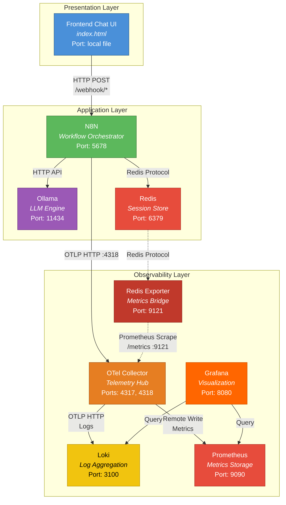
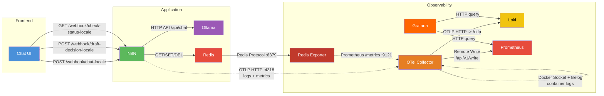
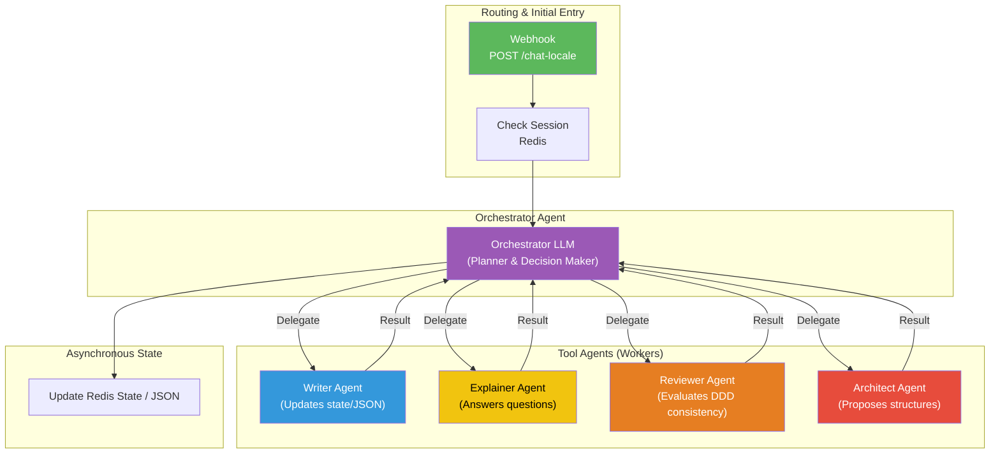
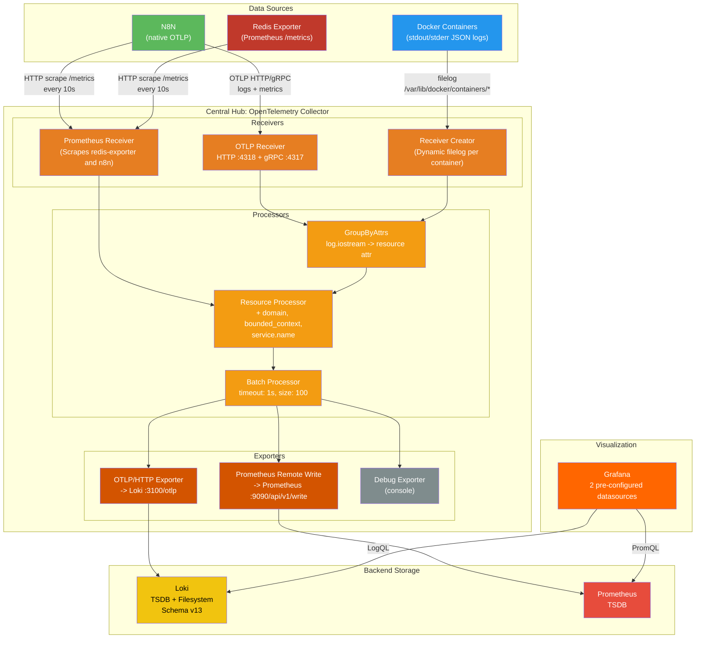
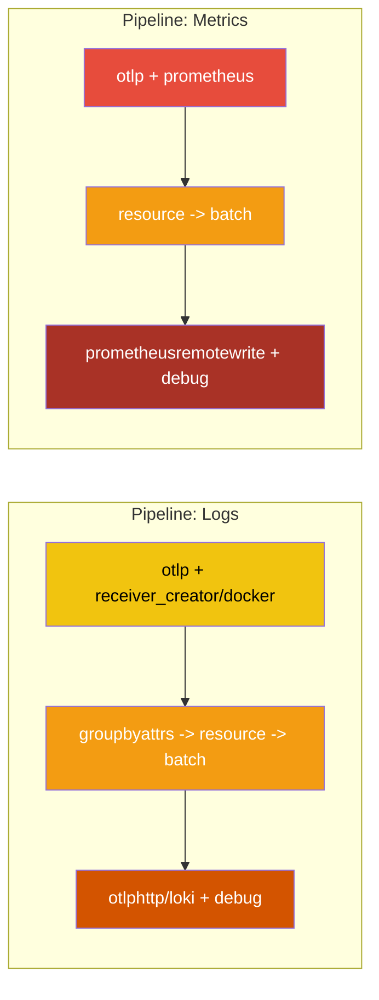
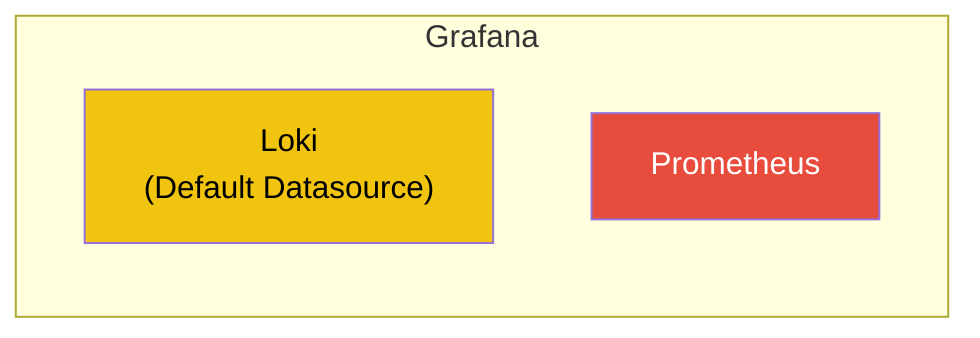

# DDD Interviewer Agent - Microservices Architecture

> **An LLM-powered conversational agent that guides users through Domain-Driven Design (DDD) modeling, backed by a fully observable microservices infrastructure.**

The system interviews the user to understand their business domain, automatically generates a structured DDD architecture (Bounded Contexts, Aggregates, Entities, Value Objects, Domain Events), and supports refinement iterations through a draft/confirm safe-lock mechanism.

---

## Table of Contents

- [Project Overview](#project-overview)
- [Technology Stack](#technology-stack)
- [General Microservices Architecture](#general-microservices-architecture)
- [Communication Between Microservices](#communication-between-microservices)
- [N8N Workflow Pipeline](#n8n-workflow-pipeline)
- [Observability Stack](#observability-stack)
  - [Stack Architecture](#stack-architecture)
  - [OpenTelemetry Collector (Central Hub)](#opentelemetry-collector-central-hub)
  - [Log Collection](#log-collection)
  - [Metrics](#metrics)
  - [Grafana](#grafana)
- [Frontend Chat UI](#frontend-chat-ui)
- [Project Structure](#project-structure)
- [Usage Guide](#usage-guide)
  - [Prerequisites](#prerequisites)
  - [Starting the System](#starting-the-system)
  - [N8N Configuration](#n8n-configuration)
  - [Downloading the LLM Model](#downloading-the-llm-model)
  - [Using the Agent](#using-the-agent)
  - [Accessing the Observability Dashboard](#accessing-the-observability-dashboard)
  - [Stopping the System](#stopping-the-system)
- [Exposed Ports](#exposed-ports)
- [License](#license)

---

## Project Overview

This project implements an **intelligent conversational agent** that assists users throughout the **Domain-Driven Design (DDD)** process. The system is organized as a microservices architecture orchestrated with Docker Compose, with three main functional areas:

1. **Application Layer** - N8N (workflow orchestration), Ollama (LLM inference), Redis (session state)
2. **Presentation Layer** - HTML/JS frontend with a chat interface
3. **Observability Layer** - Complete stack with OpenTelemetry, Loki, Prometheus, and Grafana

The agent operates in **three main phases**:

- **Discovery**: guided interview to extract the business domain and generate a DDD architecture in JSON format
- **Refinement**: the user can ask for explanations or propose changes to the generated architecture
- **Draft Decision**: safe-lock mechanism to confirm or reject proposed changes

---

## Technology Stack

| Component | Technology | Version | Role |
|---|---|---|---|
| **Workflow Orchestrator** | N8N | latest | Multi-step agent pipeline management |
| **LLM Engine** | Ollama | latest | Local language model inference |
| **Session Store** | Redis | Alpine | Session state, chat history, architecture JSON |
| **Metrics Exporter** | Redis Exporter | latest | Exposes Redis metrics in Prometheus format |
| **Telemetry Hub** | OpenTelemetry Collector Contrib | 0.133.0 | Centralized log and metric collection |
| **Log Aggregation** | Grafana Loki | 3.5.0 | Log storage and querying |
| **Metrics Storage** | Prometheus | 2.53.0 | Time-series metrics storage |
| **Visualization** | Grafana | 12.2 | Dashboards, alerting, signal correlation |
| **Frontend** | HTML/CSS/JS | - | User chat interface |

---

## General Microservices Architecture

The system consists of **8 Docker containers** connected to a single bridge network (`rete_unica`). The architecture clearly separates application services from observability services.



### Docker Network

All services communicate through a single Docker bridge network:

```yaml
networks:
  rete_unica:
    driver: bridge
    name: rete_unica
```

This enables automatic DNS resolution between containers through the service name, for example `redis:6379`, `ollama:11434`, and `loki:3100`.

---

## Communication Between Microservices

Microservices communicate through different protocols depending on the interaction type. The following diagram shows all communication flows and their protocols:



### Protocol Summary Table

| Source | Destination | Protocol | Port | Description |
|---|---|---|---|---|
| Frontend | N8N | HTTP REST | 5678 | Webhooks for chat messages, draft decisions, and status polling |
| N8N | Ollama | HTTP API | 11434 | LLM calls for DDD generation and analysis |
| N8N | Redis | Redis Protocol | 6379 | Session state, chat history, and JSON read/write |
| N8N | OTel Collector | OTLP HTTP | 4318 | Structured telemetry (logs, metrics) |
| Redis | Redis Exporter | Redis Protocol | 6379 | Redis metrics scraping |
| Redis Exporter | OTel Collector | Prometheus HTTP | 9121 | `/metrics` endpoint scraped every 10 seconds |
| OTel Collector | Loki | OTLP HTTP | 3100 | Logs from all containers and structured N8N logs |
| OTel Collector | Prometheus | Remote Write | 9090 | Metrics through `/api/v1/write` |
| Grafana | Loki, Prometheus | HTTP | various | Queries for visualization and correlation |

---

## N8N Workflow Pipeline

The system uses an **Orchestrator-Workers** architecture implemented through interconnected N8N workflows. This architecture replaces a rigid pipeline with a flexible agentic model, where a central orchestrator delegates tasks to specialized tools (agents).



### Agent Architecture Details

The agent no longer follows a fixed linear flow (Discovery -> Refinement). Control is centralized in the **Orchestrator**, an LLM programmed with Reflection and Planning prompts.

#### 1. Routing Endpoint

The **entry point** receives requests from the frontend. It manages chat history by loading it from Redis and passes the updated context to the Orchestrator.

#### 2. Orchestrator Agent

The system's "brain". It analyzes the user's input and the current DDD architecture JSON. Instead of responding directly, it decides which **Worker Tool** to call for specific tasks. The Orchestrator can also end the conversation turn by asking the user for more details.

#### 3. Worker Agents (Tools)

Subordinate workflows called by the Orchestrator:

- **Writer Agent**: the only agent authorized to mutate the architecture JSON. It receives validated decisions and updates the state in Redis.
- **Explainer Agent**: analyzes the current JSON and answers the user's questions or explanation requests.
- **Reviewer Agent**: evaluates whether proposed changes follow Domain-Driven Design principles or create inconsistencies.
- **Architect Agent**: supports initial generation or broader structural mutations of the architecture.

#### 4. Polling Workflow

The frontend performs **polling every 3 seconds** on this endpoint to check the status of asynchronous operations. The workflow checks three Redis keys:

- `discovery_json` - result of the current architecture
- `draft_json` - change draft (proposed but not yet approved)
- `draft_status` - draft status

#### 5. Draft Decision Workflow

This implements the **safe-lock** mechanism for JSON state transitions:

- **Confirm** -> `draft_json` is promoted to `discovery_json` (the current architecture is overwritten)
- **Reject** -> `draft_json` is deleted

In both cases, the temporary memory for the modification session is cleared.

---

## Observability Stack

The observability stack implements the **two pillars of modern observability**: **Logs** and **Metrics**, with aggregation and visualization in Grafana.

### Stack Architecture



### OpenTelemetry Collector (Central Hub)

The **OpenTelemetry Collector Contrib** (`otel/opentelemetry-collector-contrib:0.133.0`) is the core of the observability stack. It acts as a centralized hub that receives, processes, and routes all telemetry signals.

#### Extensions

- **Docker Observer** (`docker_observer`): automatically discovers all running Docker containers through the Docker socket (`/var/run/docker.sock`). For each container, it exposes name, container_id, image, port, and labels.

#### Receivers (3 sources)

| Receiver | Type | Source | Signals |
|---|---|---|---|
| `otlp` | OTLP HTTP/gRPC | N8N | Structured logs + metrics |
| `receiver_creator/docker` | Dynamic Filelog | All Docker containers | Logs (stdout/stderr) |
| `prometheus` | Prometheus Scraper | Redis Exporter and n8n | Metrics |

The **Receiver Creator** is especially sophisticated: it **dynamically** creates a `filelog` receiver for **each container** discovered by the `docker_observer`. The rule `type == "container" && name != "otel-collector"` excludes the collector itself to avoid feedback loops. For each container, the log path is resolved dynamically:

```text
/var/lib/docker/containers/{container_id}/{container_id}-json.log
```

Docker logs in JSON format, for example `{"log":"...","stream":"stdout","time":"..."}`, are parsed through pipeline operators:

1. **json_parser** - extracts the log body and timestamp
2. **move (body)** - moves `attributes.log` -> `body`
3. **move (stream)** - renames `attributes.stream` -> `attributes["log.iostream"]`

The **resource attributes** (`container.name`, `container.id`, `container.image.name`) are injected dynamically by Docker Observer, making each log filterable by container in Grafana.

#### Processors (3-stage pipeline)

| Processor | Function |
|---|---|
| `groupbyattrs` | Promotes `log.iostream` from log attribute to **resource attribute** (required by Loki) |
| `resource` | Adds static DDD attributes: `domain=core_domain`, `bounded_context=domain_modeling`, `service.name=agent_1_interviewer` |
| `batch` | Groups records into batches (1s timeout, max 100 records) for network efficiency |

#### Exporters (3 destinations)

| Exporter | Protocol | Destination | Signals |
|---|---|---|---|
| `otlphttp/loki` | OTLP HTTP | `loki:3100/otlp` | Logs |
| `prometheusremotewrite` | Remote Write | `prometheus:9090/api/v1/write` | Metrics |
| `debug` | Console | stdout | All signals (debug) |

#### Collector Pipelines



### Log Collection

Loki receives logs from the OTel Collector and indexes them with **OTLP labels**. The `otlp_config` in Loki defines which resource attributes are promoted to indexed labels:

| Label | Source | Description |
|---|---|---|
| `service_name` | OTel resource processor | Service name (`agent_1_interviewer`) |
| `container_name` | Docker Observer | Human-readable container name, for example `agente_interviewer_n8n` |
| `container_id` | Docker Observer | Docker container ID |
| `container_image_name` | Docker Observer | Docker image, for example `docker.n8n.io/n8nio/n8n` |
| `log_iostream` | GroupByAttrs processor | Log stream (`stdout` / `stderr`) |
| `domain` | OTel resource processor | DDD domain (`core_domain`) |
| `bounded_context` | OTel resource processor | Bounded Context (`domain_modeling`) |

Loki is configured with:

- **TSDB v13 schema** for efficient indexing
- **Retention**: rejects logs older than 7 days
- **Rate limiting**: 10 MB/s ingestion rate per tenant
- **Compactor**: optimizes storage every 10 minutes

### Metrics

Metrics reach Prometheus through three channels:

1. **OTLP from N8N** -> OTel Collector -> Prometheus Remote Write
2. **N8N scraping** -> N8N `/metrics` endpoint (:5678) -> OTel Collector (Prometheus receiver) -> Prometheus Remote Write
3. **Redis scraping** -> Redis Exporter (:9121) -> OTel Collector (Prometheus receiver) -> Prometheus Remote Write

> **Note**: Prometheus is configured exclusively in **Remote Write receiver** mode (`--web.enable-remote-write-receiver`). It does not perform direct scraping; all metrics pass through the OTel Collector.

The Redis Exporter exposes metrics such as:

- Active and total connections
- Used memory
- Operations per second
- Keyspace statistics
- Command latency

### Grafana

Grafana is pre-configured with **2 datasources**:



---

## Frontend Chat UI

The frontend is an HTML/CSS/JS **Single Page Application** (SPA) that implements an interactive chat interface, served as a local static file.

### Main Features

- **Multi-turn chat** with the DDD agent
- **Persistent session** through `localStorage` (`sessionId`)
- **Three interaction modes**:
  - **Discovery**: the agent interviews the user
  - **Explain**: the user asks questions about the architecture
  - **Modify**: the user requests structural changes
- **JSON rendering** with syntax highlighting and a "Copy JSON" button
- **Markdown rendering** for architecture documents through `marked.js`
- **Draft mechanism** with Confirm/Reject buttons and double confirmation (safe-lock)
- **Asynchronous polling** every 3 seconds for long-running operations
- **Loading animations**: typing indicator (3 dots), progress bar, and animated text
- **Responsive design** with mobile support

### Webhook Endpoints Used

| Endpoint | Method | Description |
|---|---|---|
| `/webhook/chat-locale` | POST | Sends user messages with `message`, `sessionId`, and `action` |
| `/webhook/check-status-locale` | GET | Polls asynchronous operation status |
| `/webhook/draft-decision-locale` | POST | Confirms or rejects proposed changes |

---

## Project Structure

```text
Progetto_Microservizi/
|
+-- docker-compose.yml          # Defines all 8 services and the network
+-- .gitignore                  # Git exclusions (runtime data, secrets, logs)
+-- README.md                   # This file
|
+-- frontend/                   # Presentation Layer
|   +-- index.html              # Chat UI SPA (integrated HTML + CSS + JS)
|
+-- workflow/                   # N8N workflows (JSON exports)
|   +-- Routing_locale.json             # Routing: message dispatching
|   +-- DISCOVERY WORKFLOW_locale.json  # Discovery: multi-turn DDD interview
|   +-- REFINEMENT WORKFLOW_locale.json # Refinement: explain + modify
|   +-- POLLING WORKFLOW_LOCALE.json    # Polling: asynchronous status check
|   +-- DRAFT DECISION WORKFLOW_locale.json # Draft Decision: confirm/reject
|
+-- otel-collector/             # OTel Collector configuration
|   +-- collector.yaml          # Receivers, processors, exporters, pipelines
|
+-- loki/                       # Loki configuration
|   +-- loki-config.yml         # TSDB schema, limits, OTLP label config
|
+-- prometheus/                 # Prometheus configuration
|   +-- prometheus.yml          # Remote Write receiver (no direct scraping)
|
+-- grafana/                    # Grafana configuration
|   +-- provisioning/
|       +-- datasources/
|       |   +-- datasources.yml # 2 datasources: Loki, Prometheus
|       +-- dashboards/
|           +-- dashboard.yml   # Automatic dashboard provisioning
|
+-- Data_N8N/                   # Persistent N8N volume (gitignored)
+-- Data_Ollama/                # Persistent Ollama/model volume (gitignored)
+-- Data_Redis/                 # Persistent Redis volume (gitignored)
+-- .runtime/                   # Runtime data for Loki/Prometheus/Grafana (gitignored)
```

---

## Usage Guide

### Prerequisites

| Requirement | Minimum Version | Notes |
|---|---|---|
| **Docker** | 20.10+ | With Docker Compose V2 support |
| **Docker Compose** | 2.x | Integrated in Docker Desktop |
| **Available RAM** | >= 8 GB | Ollama + LLM model require significant memory |
| **Disk space** | >= 10 GB | For LLM models and observability data |
| **Operating System** | Windows / macOS / Linux | Docker Desktop or Docker Engine |

> **Windows note**: Docker Desktop must be started with the WSL2 backend. The OTel Collector requires access to `/var/lib/docker/containers` and `/var/run/docker.sock`, which are available only with the Linux/WSL2 backend.

### Starting the System

1. **Clone the repository:**

   ```bash
   git clone https://github.com/<your-username>/Progetto_Microservizi.git
   cd Progetto_Microservizi
   ```

2. **Start all services:**

   ```bash
   docker compose up -d
   ```

   This command starts all 8 containers in order, respecting their dependencies (`depends_on`):

   - First: Loki, Redis, Ollama
   - Then: OTel Collector, Prometheus, Redis Exporter
   - Finally: Grafana, N8N

3. **Check container status:**

   ```bash
   docker compose ps
   ```

   All containers should show the `Up` or `running` status.

4. **Inspect logs (optional):**

   ```bash
   docker compose logs -f
   ```

### N8N Configuration

On first startup, N8N requires initial configuration:

1. **Access N8N**: open `http://localhost:5678` in your browser.
2. **Create a local account** (email + password, local only).
3. **Import the workflows**: for each file in the `workflow/` folder:
   - Go to **Workflow** -> **Import from File**
   - Select the corresponding JSON file
   - Repeat for all 5 workflows, which make up the new agentic architecture
4. **Configure Redis credentials**:
   - In N8N, go to **Credentials** -> **New Credential**
   - Type: **Redis**
   - Host: `redis` (Docker service name)
   - Port: `6379`
   - Save
5. **Activate the workflows**:
   - Open each workflow and enable the **Active** toggle in the top-right corner
   - Workflows exposing webhooks must be active: `Routing_locale`, `POLLING WORKFLOW_LOCALE`, `DRAFT DECISION WORKFLOW_locale`

### Downloading the LLM Model

Ollama starts without preloaded models. At least one model must be downloaded:

```bash
# Access the Ollama container
docker exec -it agente_interviewer_ollama bash

# Download a model (example with llama3.2)
ollama pull llama3.2

# Or use a lighter model for quick tests
ollama pull phi3:mini
```

> **Tip**: the chosen model must match the one configured in the N8N "AI Agent" nodes. Check the LLM nodes in the Discovery and Refinement workflows.

### Using the Agent

1. **Open the frontend**: open `frontend/index.html` directly in the browser by double-clicking it or using `File -> Open`.

2. **Discovery phase**:
   - Write a message describing your business domain
   - The agent asks questions to understand bounded contexts, entities, aggregates, and related concepts
   - At the end, a DDD architecture is generated in JSON format
   - A "Generating architecture..." animation indicates that the process is running

3. **Refinement phase**:
   - After generation, two buttons appear: **Ask for Explanation** and **Request Change**
   - **Explanation**: ask questions about the generated architecture
   - **Change**: request structural changes

4. **Draft Decision** (changes only):
   - The agent proposes a change draft
   - Two buttons appear: **Confirm Change** / **Reject Change**
   - The **safe-lock** mechanism requests a second confirmation before applying the change
   - If confirmed, the current architecture is updated
   - If rejected, the previous architecture remains active

5. **New Chat**:
   - Click the "New Chat" button in the header to reset the session

### Accessing the Observability Dashboard

| Service | URL | Credentials |
|---|---|---|
| **Grafana** | [http://localhost:8080](http://localhost:8080) | `admin` / `admin` (anonymous access enabled) |
| **Prometheus** | [http://localhost:9090](http://localhost:9090) | None |
| **Loki** (API) | [http://localhost:3100](http://localhost:3100) | None |
| **N8N** | [http://localhost:5678](http://localhost:5678) | Credentials created on first startup |

#### Exploring Logs in Grafana

1. Access Grafana -> **Explore**
2. Select **Loki** as the datasource
3. Use LogQL to filter, for example:

   ```logql
   {container_name="agente_interviewer_n8n"} |= "error"
   ```

   ```logql
   {container_name=~"agente_interviewer.*"}
   ```

#### Redis Metrics in Grafana

1. Grafana -> **Explore** -> **Prometheus**
2. Example queries:

   ```promql
   redis_connected_clients
   ```

   ```promql
   rate(redis_commands_total[5m])
   ```

#### Pre-configured Global Dashboard

When the system starts, Grafana automatically loads a centralized dashboard through provisioning.

1. Access Grafana
2. Go to **Dashboards** (left icon) -> **General**
3. Select the **Agente DDD Interviewer - Observability** dashboard
4. This dashboard provides a consolidated view of all microservices, including:
   - **N8N**: workflow executions, latencies, active memory
   - **Ollama**: generated requests, LLM processing, and GPU usage when applicable
   - **Redis**: cache state, memory, and hit rate
   - **OTel Collector**: log export queues and ingestion status

### Stopping the System

```bash
# Stop all services
docker compose down

# Stop and remove volumes as well (full reset)
docker compose down -v
```

---

## Exposed Ports

| Port | Service | Protocol | Description |
|---|---|---|---|
| `5678` | N8N | HTTP | UI + Webhook API |
| `6379` | Redis | Redis | Session store |
| `8080` | Grafana | HTTP | Dashboard (mapped from internal :3000) |
| `9090` | Prometheus | HTTP | Metrics UI + Remote Write |
| `9121` | Redis Exporter | HTTP | `/metrics` endpoint |
| `3100` | Loki | HTTP | Log API + OTLP endpoint |
| `4317` | OTel Collector | gRPC | OTLP gRPC receiver |
| `4318` | OTel Collector | HTTP | OTLP HTTP receiver |
| `11434` | Ollama | HTTP | LLM API |

---

## License

This project is developed for academic and educational purposes.
